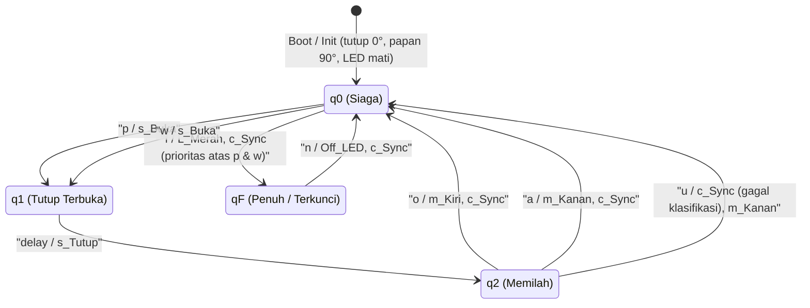

# Diagram State, Training YOLO, dan Verifikasi End-to-End

## 1. Diagram State FST Mealy (Konsisten dengan Gambar 2 Laporan + Ekstensi `u`)



---

## 2. Alur Training Model YOLO (`vision/`)

### A. Mengapa `yolo11n-cls` dipilih sebagai Default?
1. Pada papan pengarah tempat sampah pintar, objek yang dipilah masuk **satu per satu** setelah tutup tertutup (`q1 -> q2`).
2. Dataset publik organik vs anorganik paling populer—seperti **Waste Classification data (`techsash`) di Kaggle** yang berisi kelas `O` (*Organic*) dan `R` (*Recyclable*)—maupun foto lokal dari `capture_images.py` hanya memiliki **label per folder gambar**, tanpa koordinat kotak pembatas (*bounding box*).
3. Model klasifikasi (`yolo11n-cls`) langsung dilatih pada data tersebut dengan akurasi lebih tinggi untuk objek tunggal dan waktu training lebih cepat.
4. Sebagai pembanding, jika Anda menggunakan dataset **deteksi objek** yang sudah memiliki anotasi kotak (misalnya dataset sampah dari **Roboflow Universe** atau **TACO**), proyek ini tetap mendukung penuh mode deteksi (`yolo11n.pt` + `data.yaml`) dengan mengatur `YOLO_TASK=detect` di `.env` dan `--task detect` di `train.py`.

### B. Sumber Dataset & Cara Memetakan ke 2 Kelas (`organic` & `inorganic`)
1. **Kaggle "Waste Classification data" (`techsash`)**: memiliki 2 folder utama `O` (Organic) dan `R` (Recyclable) yang terbagi ke `TRAIN/` dan `TEST/`.
   - Di `vision/waste_mapping.py`: `o` / `organic` -> `organic`; `r` / `recyclable` -> `inorganic`.
2. **Roboflow Universe / TACO**: umumnya memiliki banyak sub-kelas seperti `plastic`, `bottle`, `can`, `metal`, `glass`, `cardboard`, `paper`, `food_waste`.
   - Buka `data.yaml` bawaan dataset yang Anda unduh, lalu cocokkan tiap nama kelasnya di `WASTE_CLASS_MAPPING` dalam `vision/waste_mapping.py`:
     - **Organic**: sisa makanan, buah, sayur, daun, kertas basah.
     - **Inorganic**: plastik, botol, kaleng, logam, kaca, kardus, kertas kering, kemasan.
   > Catatan jujur: Penamaan kelas pada dataset TACO atau proyek Roboflow berbeda-beda antar pembuat dataset; selalu periksa isi `data.yaml` atau nama folder dataset hasil unduhan terlebih dahulu dan sesuaikan di `waste_mapping.py`.
3. **Sangat Disarankan — Foto Webcam Asli (150–300 foto/kelas)**:
   Letakkan berbagai contoh sampah di atas papan pengarah tempat sampah yang sebenarnya, nyalakan lampu ruangan normal, lalu jalankan:
   ```bash
   cd vision
   python3 capture_images.py
   ```
   Gabungkan foto Kaggle + foto webcam:
   ```bash
   python3 prepare_dataset.py --kaggle-dir ~/Downloads/DATASET --webcam-dir datasets/webcam_raw
   ```

### C. Training & Membaca Hasil
```bash
cd vision
python3 train.py --task classify --epochs 60 --imgsz 640 --device cpu
```
*(Ganti `--device 0` untuk GPU NVIDIA atau `--device mps` untuk Mac Apple Silicon).*

Cara membaca hasil pada `runs/classify/smart_bin_cls/`:
- **`results.csv` / `results.png`**: Perhatikan nilai `metrics/accuracy_top1` pada validasi (target baik >= `0.85`). Jika memakai `--task detect`, perhatikan `mAP50` dan `mAP50-95`.
- **`confusion_matrix.png`**: Diagonal utama menunjukkan prediksi benar. Jika banyak `organic` salah masuk ke `inorganic` (atau sebaliknya), periksa apakah foto kelas tersebut kurang pencahayaan atau mirip latar papan pengarah.
- **Cara memperbaiki jika akurasi rendah**: tambah 100–200 foto webcam asli dengan variasi posisi & pencahayaan, bersihkan gambar blur/salah label, pastikan latar papan pengarah kontras polos, atau tambah epoch ke `80–100`.

---

## 3. Skenario Verifikasi End-to-End

Berikut skenario uji lengkap menghubungkan **Laptop (YOLO + Webcam) -> USB Serial -> ESP32 (`SIMULATION_MODE = true`) -> Supabase -> Web Dashboard Next.js (Realtime)**:

1. **Siapkan Supabase & Dashboard (`web/`)**:
   - Jalankan `01_schema.sql`, `02_rls_and_realtime.sql`, `03_seed.sql` di Supabase.
   - Jalankan `npm run dev` di folder `web/`, buka `http://localhost:3000/login`, login sebagai admin. Dashboard tampil dengan status awal `q0 — Siaga`.
2. **Siapkan ESP32 (`SIMULATION_MODE = true`)**:
   - Isi `firmware/smart_bin_fst/secrets.h` dengan WiFi 2.4 GHz & Supabase URL/anon key.
   - Ubah `SIMULATION_MODE` ke `true` di `config.h`, lalu upload firmware ke ESP32.
3. **Jalankan Program Vision (`vision/main.py`)**:
   - Isi `vision/.env` (dari `.env.example`), jalankan `python3 main.py`.
   - Program membuka webcam dan menampilkan preview dengan `ESP32 State: q0`.
4. **Uji Jalur Organik via Dashboard Force Open (`w`)**:
   - Klik tombol **"Buka Tutup"** pada Web Dashboard.
   - Dalam <= 2 detik ESP32 melakukan polling `bin_commands`, menerima `w`, menjalankan `[q0] --w / s_Buka--> [q1]`, tutup terbuka 5 detik (`q1`), lalu masuk `q2` dan mengirim `STATE:q2` via USB Serial.
   - Program Python menangkap `STATE:q2`, mengumpulkan prediksi frame selama `1,5 detik` (arahkan sampah organik seperti kulit buah/daun ke webcam), melakukan voting mayoritas, dan mengirim `CLS:organic`.
   - ESP32 menjalankan `[q2] --o / m_Kiri, c_Sync--> [q0]`, memiringkan Servo 2 ke kiri `1,5 detik`, mengembalikannya ke netral `90°`, menyinkronkan ke Supabase, lalu kembali ke `q0`.
   - **Hasil di Dashboard (tanpa refresh)**: Transisi terakhir langsung muncul `q2 --o / m_Kiri, c_Sync--> q0`, ringkasan *Organik Hari Ini* bertambah `+1`, dan daftar 20 kejadian terbaru bertambah di baris teratas!
5. **Uji Fallback Tanpa ESP32 (`--mock-serial` & `--test-image`)**:
   - Uji 1 gambar: `python3 main.py --test-image contoh.jpg`
   - Uji webcam tanpa ESP32: `python3 main.py --mock-serial`, lalu tekan tombol `t` pada jendela preview untuk mensimulasikan `STATE:q2` dan lihat perintah `CLS:...` tercetak di terminal.
